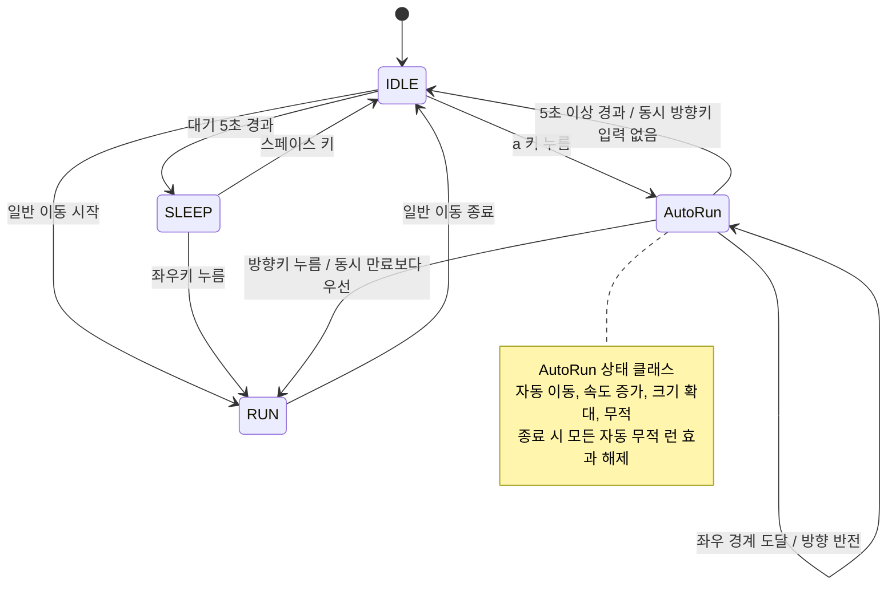

# PRD: 소년 캐릭터 자동 무적 런

## 1. 문서 개요

| 항목      | 내용                                                            |
| --------- | --------------------------------------------------------------- |
| 프로젝트  | DRILL11                                                         |
| 기준 문서 | `PRE-PRD.md`                                                  |
| 목적      | 자동 무적 런 기능을 구현하고 검증할 수 있는 개발 요구 사항 정의 |
| 문서 상태 | 개발 기준. 기초 코드 및 사용자 확인 사항 반영                   |
| 핵심 상태 | `IDLE`, `RUN`, `AutoRun`                                  |

`IDLE`과 `RUN`은 일반 대기 및 이동 상태이며 기존 `SLEEP`도 유지한다. `boy.py`의 독립된 `AutoRun` 클래스가 자동 무적 런의 진입, 입력, 갱신, 종료를 담당하고, `transitions.Machine`이 상태 간 전환을 관리한다.

## 2. 목표와 범위

### 2.1. 사용자 목표

사용자는 대기 중인 소년에게 `a` 키를 입력해 일시적인 자동 무적 런을 발동할 수 있다. 소년은 커진 모습으로 빠르게 좌우를 자동 이동하며, 사용자는 방향키로 자동 이동을 취소하고 직접 이동할 수 있다.

### 2.2. 필수 개발 범위

- `IDLE`에서 `a` 키를 눌렀을 때 `AutoRun` 진입.
- 추가 키 조작 없이 지속되는 좌우 자동 이동과 화면 양 끝에서의 방향 전환.
- 일반 상태 대비 이동 속도 증가, 캐릭터 크기 확대, 무적 효과.
- 진입 후 5초 이상 경과하면 `IDLE` 복귀.
- 방향키 입력 시 즉시 자동 무적 런 취소 및 해당 방향의 일반 `RUN` 전환.
- 독립된 `AutoRun` 상태 클래스와 상태 전환 구조.
- 제출 문서에 상태 다이어그램 포함.
- 개발 과정에서 한국어 커밋 메시지 사용 및 커밋 개수 20개 준수.

### 2.3. 범위 제외

- 새로운 전투, 적, 점수, 스테이지, 아이템 시스템.
- 원문에 없는 쿨다운, 사용 횟수 제한, 추가 발동 키.
- 자동 무적 런과 무관한 일반 이동 규칙 변경.
- 신규 이미지 제작이나 기존 에셋의 전면 교체.

무적 효과를 검증하기 위해 피해 판정과의 연동은 필요할 수 있으나, 이를 이유로 별도의 전투 시스템까지 신규 개발하지 않는다.

## 3. 저장소 현황과 전제

저장소에는 `main.py`, `boy.py`, `grass.py` 기초 코드와 아래 이미지 파일이 있다. Python, `pico2d`, `transitions.Machine`을 사용한다.

| 파일                                 | 개발 시 확인 사항                               |
| ------------------------------------ | ----------------------------------------------- |
| `animation_sheet.png`              | 캐릭터 동작에 사용할 수 있는지 프레임 구성 확인 |
| `run_animation.png`                | 달리기 표현에 사용할 수 있는지 프레임 구성 확인 |
| `ball21x21.png`, `ball41x41.png` | 실제 용도 확인 후 필요한 경우에만 사용          |
| `grass.png`                        | 배경 또는 지면 표현에 사용할 수 있는지 확인     |

기본 화면은 800 x 600이며 소년 100명을 함께 생성하는 기존 구성을 유지한다. 일반 이동 속도는 초당 200픽셀, 표시 크기는 100 x 100이다. 기존 `IDLE`, `RUN`, `SLEEP`과 스페이스 키의 깨우기 동작을 보존한다. 피해 및 체력 시스템은 없으므로 피해 허용 여부를 조회하는 인터페이스와 검증용 피해 테스트로 무적 효과를 확인한다.

## 4. 기능 요구 사항

### FR-01. 자동 무적 런 진입

- 현재 상태가 `IDLE`이고 `a` 키 누름 입력이 발생하면 `AutoRun`으로 전환해야 한다.
- 진입 시 자동 이동, 무적, 증가된 속도, 확대된 크기를 함께 적용해야 한다.
- 진입 시점을 기준으로 지속 시간을 새로 측정해야 한다.
- 키를 놓아도 자동 무적 런이 유지되어야 한다.
- 최초 진행 방향은 원문에 없으므로 7장의 제안 정책을 따른다.

### FR-02. 자동 이동과 속도 증가

- `AutoRun`에서는 이동키를 계속 누르지 않아도 현재 진행 방향으로 이동해야 한다.
- 자동 이동 속도는 일반 `RUN`의 이동 속도보다 커야 한다.
- 속도 배율은 조정 가능한 값으로 분리한다. 채택한 기본값은 `2.0`이다.
- 이동량은 실제 경과 시간을 반영해 계산하며, 프레임 수에 따라 이동 속도가 달라지지 않도록 해야 한다.

### FR-03. 캐릭터 확대

- `AutoRun` 중 캐릭터의 표시 크기는 일반 상태보다 커야 한다.
- 원본 이미지의 가로세로 비율을 유지해야 한다.
- 크기 배율은 조정 가능한 값으로 분리한다. 채택한 기본값은 `2.0`이다.
- 확대된 캐릭터의 표시 영역을 기준으로 좌우 경계를 계산해야 한다.
- 확대가 피해 판정 영역에도 영향을 주는지는 기존 충돌 구조 확인 후 결정한다. 화면 경계 판정에는 확대 크기를 반드시 반영한다.

### FR-04. 화면 경계에서 자동 방향 전환

- 캐릭터가 화면 왼쪽 끝에 도달하면 오른쪽으로, 오른쪽 끝에 도달하면 왼쪽으로 자동 전환해야 한다.
- 방향 전환 후에도 `AutoRun`을 유지하고 추가 입력 없이 이동을 계속해야 한다.
- 경계에 도달하더라도 지속 시간을 초기화해서는 안 된다.
- 캐릭터 중심 좌표가 아니라 확대된 표시 영역의 좌우 끝을 기준으로 판단해야 한다.
- 한 프레임의 이동으로 경계를 넘은 경우에도 위치를 유효 범위로 보정하고 진행 방향을 안쪽으로 바꿔야 한다.
- 선택한 화면 크기와 확대 배율은 확대된 캐릭터가 화면 안에 들어갈 수 있는 조합이어야 한다.

### FR-05. 5초 후 자동 종료

- `AutoRun` 진입 이후의 경과 시간이 `5.0`초 이상이면 `IDLE`로 전환해야 한다.
- 종료 판단은 프레임 횟수가 아닌 경과 시간을 기준으로 해야 한다.
- 프레임 단위로 갱신하는 경우, 경과 시간이 `5.0`초 이상이 된 첫 갱신에서 종료해야 한다.
- 종료 후 자동 이동이 멈추고 일반 대기 상태가 되어야 한다.
- 재진입 시 이전 실행의 경과 시간을 이어 사용해서는 안 된다.

### FR-06. 방향키 입력에 의한 취소

- `AutoRun` 중 방향키 누름 입력이 발생하면 5초가 지나기 전이라도 자동 무적 런을 취소해야 한다.
- 취소 후에는 일반 `RUN`으로 전환하고, 입력한 방향을 일반 이동에 전달해야 한다.
- 기존 자동 이동 방향과 입력 방향이 다르면 사용자가 입력한 방향을 적용해야 한다.
- 취소를 일으킨 입력을 버려서 사용자가 같은 키를 다시 누르게 해서는 안 된다.
- 사용자 확인에 따라 취소용 방향키는 기존 이동키인 왼쪽 및 오른쪽으로 한정한다. 상하키는 기존처럼 처리하지 않는다.

### FR-07. 무적 효과와 종료 시 복원

- `AutoRun` 유지 중에는 피해로 인해 체력이 감소하거나 피격 상태로 전환되어서는 안 된다.
- 피해 판정이 존재한다면 실제 피해 처리 경로에서 무적 상태를 반영해야 한다. 단순 시각 효과만으로 무적을 대체할 수 없다.
- 기초 코드에 피해 판정이 없다면 무적 상태를 조회할 수 있게 하고, 검증용 피해 호출 또는 테스트로 피해 차단을 확인한다.
- 시간 만료와 방향키 취소 모두 무적, 자동 이동, 속도 증가, 크기 확대를 해제해야 한다.
- 다음 상태에는 해당 상태의 일반 속도와 크기를 적용해야 한다. 이전 `AutoRun`의 효과가 남아서는 안 된다.
- 무적은 피해에 대한 효과이며, 화면 경계 처리나 사용자의 취소 입력을 무시하는 기능이 아니다.

## 5. 상태 모델과 설계 제약

### 5.1. 필수 설계

- 반드시 `AutoRun` 상태 클래스를 추가해야 한다. 기존 `RUN`에 조건문만 추가하는 구현으로 대체할 수 없다.
- `AutoRun` 클래스는 진입, 입력 처리, 프레임 갱신, 종료에 해당하는 책임을 가져야 한다. 메서드 이름은 채택한 상태 관리 구조에 맞춘다.
- 상태 변경은 일관된 전환 경로를 사용하고, 어떤 종료 경로에서도 효과 복원이 누락되지 않도록 해야 한다.
- 최소 관리 정보는 현재 상태, 위치, 진행 방향, 일반 이동 속도와 표시 크기, 자동 이동 배율, 확대 배율, 무적 여부, 진입 후 경과 시간이다. 계산 가능한 값을 별도 필드로 중복 저장할 필요는 없다.

### 5.2. 상태 전환표

| 현재 상태          | 이벤트 또는 조건                          | 다음 상태      | 필수 처리                                  |
| ------------------ | ----------------------------------------- | -------------- | ------------------------------------------ |
| `IDLE`           | `a` 키 누름                             | `AutoRun`    | 시간 초기화, 자동 이동 및 강화 효과 적용   |
| `AutoRun`        | 입력 없이 5초 미만 경과                   | `AutoRun`    | 현재 방향으로 자동 이동                    |
| `AutoRun`        | 좌우 화면 경계 도달                       | `AutoRun`    | 위치 보정, 진행 방향 반전, 시간 유지       |
| `AutoRun`        | 경과 시간 5초 이상, 동시 방향키 입력 없음 | `IDLE`       | 자동 이동과 강화 효과 해제, 정지           |
| `AutoRun`        | 방향키 누름                               | `RUN`        | 자동 이동과 강화 효과 해제, 입력 방향 전달 |
| `IDLE` / `RUN` | 기존 일반 이동 입력                       | 기존 상태 규칙 | 일반 동작 유지 또는 기초 동작 구현         |
| `IDLE`           | 일반 대기 5초 경과                        | `SLEEP`      | 기존 수면 동작 유지                        |
| `SLEEP`          | 스페이스 키 누름                          | `IDLE`       | 일반 대기 타이머와 프레임 초기화           |
| `SLEEP`          | 좌우키 누름                               | `RUN`        | 입력 방향으로 일반 이동                    |

시간 만료와 방향키 입력이 같은 갱신에서 발생하는 경우의 우선순위는 제안 정책 P-04를 적용한 것이다.

### 5.3. 제출용 상태 다이어그램

일반 이동의 키 유지 및 해제 규칙은 기존 `RUN`을 따른다. 위 다이어그램은 `boy.py`의 상태 전환과 대조한 제출용 다이어그램이며, 구현이 변경되면 함께 갱신한다.

## 6. 품질 요구 사항

- 프레임률이 달라도 자동 이동 속도와 5초 지속 시간이 일관되어야 한다.
- 경계에서 방향이 매 프레임 불필요하게 뒤집히거나 캐릭터가 화면 밖에 머물러서는 안 된다.
- 반복 진입 및 종료 시 속도나 크기 배율이 누적되어서는 안 된다.
- 모든 종료 경로에서 무적이 해제되어야 하며, 일반 상태의 피해 처리에 영향을 남겨서는 안 된다.
- `IDLE`과 `RUN`의 기존 조작 및 렌더링을 회귀 검증해야 한다.
- 에셋은 저장소의 파일을 우선 검토하고, 리소스 경로는 실행 환경에서 재현 가능하게 구성해야 한다.

## 7. 확정한 개발 정책

### 7.1. 채택한 보완 정책

아래 내용은 원문에 없는 보완 정책이며, 이번 개발에서는 제안 기본값을 채택한다. 변경되면 관련 전환표와 인수 기준도 함께 갱신한다.

| ID   | 항목                    | 제안 정책                                                                                              |
| ---- | ----------------------- | ------------------------------------------------------------------------------------------------------ |
| P-01 | 최초 자동 이동 방향     | 마지막으로 바라본 좌우 방향을 사용하고, 기록이 없으면 오른쪽 사용                                      |
| P-02 | 속도와 크기 배율        | 각각 일반 상태의 `2.0`배로 시작해 화면 크기와 에셋에 맞게 조정. 최종 값은 반드시 `1.0`보다 커야 함 |
| P-03 | 추가 `a` 입력         | `RUN`에서는 자동 무적 런을 발동하지 않고, `AutoRun`에서는 재진입하거나 타이머를 연장하지 않음      |
| P-04 | 만료와 입력의 동시 발생 | 같은 갱신에서 방향키 누름과 시간 만료를 함께 관찰하면 사용자의 방향 입력을 우선하여 `RUN`으로 전환   |
| P-05 | 시간 만료 위치          | 자동 이동이 끝난 현재 위치에서 `IDLE`로 전환하며 시작 위치로 되돌리지 않음                           |

### 7.2. 확정한 개발 기준

| 항목         | 확인 내용                                                                                      |
| ------------ | ---------------------------------------------------------------------------------------------- |
| 기술 환경    | Python, pico2d, transitions. 실행 명령은 `python main.py`                                    |
| 기초 코드    | 제공된 세 파일을 유지 및 확장. 별도 전투 시스템은 추가하지 않음                                |
| 화면 및 배율 | 800 x 600. 속도 200에서 400픽셀/초, 표시 크기 100에서 200픽셀로 확대                           |
| 방향키 범위  | 사용자 확인: 좌우키만 자동 무적 런 취소 및 일반 이동에 사용                                    |
| 동시 입력    | 일반 RUN은 기존처럼 좌우 동시 유지 시 정지. AutoRun 취소 순간에는 새로 누른 좌우키 방향을 우선 |
| 커밋 집계    | 사용자 확인: 기준 `c7118ca` 이후 이번 개발 커밋 정확히 20개 추가. 기존 3개 포함 전체 23개    |

키 해제는 자동 무적 런을 취소하지 않는다. 키를 누른 채 발생하는 반복 입력으로 지속 시간을 연장하거나 만료 직후 자동 재발동하지 않는다. 같은 갱신의 방향키 입력은 시간 만료보다 우선한다.

## 8. 인수 및 검증 기준

| ID    | 조건 및 실행                                                            | 통과 기준                                                                         |
| ----- | ----------------------------------------------------------------------- | --------------------------------------------------------------------------------- |
| AC-01 | `IDLE`에서 `a` 키를 누른 뒤 모든 키를 놓음                          | `AutoRun`에 진입하고 별도 입력 없이 이동 지속                                   |
| AC-02 | 일반 `RUN`과 `AutoRun`의 같은 시간 동안 이동 거리 및 표시 크기 비교 | 자동 무적 런의 이동 속도와 표시 크기가 각각 일반 상태보다 큼                      |
| AC-03 | 왼쪽 및 오른쪽 경계까지 자동 이동                                       | 확대된 캐릭터가 화면 안에 있도록 보정되고 반대 방향으로 이동. 타이머는 유지       |
| AC-04 | 입력 없이 경과 시간을 5초 전후로 진행                                   | 5초 미만에는 `AutoRun` 유지, 5초 이상인 첫 갱신에 `IDLE` 전환 및 정지         |
| AC-05 | `AutoRun` 중 왼쪽 및 오른쪽 키를 각각 누름                            | 즉시 일반 `RUN`으로 전환하고 누른 방향으로 이동                                 |
| AC-06 | 자동 진행 방향과 반대 방향의 키를 누름                                  | 자동 방향이 아닌 입력 방향 적용. 재입력 불필요                                    |
| AC-07 | 피해 처리 경로에 동일한 피해를 일반 상태와 `AutoRun`에서 전달         | 일반 상태에는 기존 피해 규칙 적용, `AutoRun`에는 체력 감소 및 피격 전환 없음    |
| AC-08 | 시간 만료 종료와 방향키 취소를 각각 실행                                | 두 경로 모두 무적 및 배율 효과가 해제되고 다음 상태의 정상 속도와 크기 적용       |
| AC-09 | 종료 후 `IDLE`에서 다시 발동하는 과정을 반복                          | 매번 지속 시간이 초기화되고 속도 및 크기 배율 누적 없음                           |
| AC-10 | 지원 환경에서 서로 다른 프레임 간격으로 동일 시간 갱신                  | 벽 충돌이 없는 구간의 이동 거리와 종료 시점이 프레임 수가 아닌 시간 기준으로 일치 |
| AC-11 | 클래스와 상태 전환 코드 검토                                            | 실제 `AutoRun` 상태 클래스가 존재하고 진입, 갱신, 입력, 종료 처리에 사용됨      |
| AC-12 | 최종 문서와 실행 결과 대조                                              | 제출용 상태 다이어그램이 포함되고 구현의 상태 전환과 일치                         |
| AC-13 | 합의된 집계 범위의 Git 이력 확인                                        | 커밋이 정확히 20개이며 각 커밋 메시지가 한국어로 변경 의도를 설명                 |
| AC-14 | P-03 정책으로 `RUN` 및 `AutoRun`에서 `a` 키 반복 입력             | 새 발동이나 타이머 연장 없음                                                      |
| AC-15 | P-04 정책으로 5초 만료와 방향키 입력을 같은 갱신에 전달                 | `IDLE` 대신 입력 방향의 일반 `RUN`으로 전환                                   |
| AC-16 | 확정한 상하키 및 동시 입력 정책으로 자동 무적 런 중 방향키 입력         | 방향키 취소가 누락되지 않고 합의한 일반 `RUN` 방향 규칙 적용                    |

AC-14, AC-15는 채택한 보완 정책에 따라 검증한다. AC-16은 상하키 무시, 취소 순간 새 좌우 입력 우선, 일반 RUN에서 좌우 동시 유지 시 정지를 확인한다. 기존 SLEEP 진입과 깨우기도 회귀 검증한다. 경계 및 시간 테스트는 경과 시간을 직접 제어하는 자동화 테스트로 수행하고, 확대 표시와 실제 조작감은 실행 화면에서 확인한다.

## 9. 개발 및 제출 요구 사항

### 9.1. 커밋 규칙

- 모든 개발은 작업 진행에 따라 한국어 커밋 메시지를 남기며 수행해야 한다.
- 합의된 집계 범위에서 최종 커밋 개수는 정확히 20개여야 한다.
- 클래스 이름 등 기술 식별자는 영문으로 포함할 수 있으나, 변경 의도는 한국어로 설명한다. 예: `자동 무적 런 상태 진입 처리 추가`.
- 구현, 검증, 문서화 등 의미 있는 작업 단위로 나누고 커밋 수를 맞추기 위한 빈 커밋은 만들지 않는다.
- 기존 이력의 삭제나 재작성 없이 집계 기준을 먼저 확인하고, 개발 중 개수를 계속 관리한다.

### 9.2. 제출물

- 실행 가능한 프로젝트 코드 및 필요한 리소스.
- `AutoRun` 상태 클래스와 기존 상태의 연동 코드.
- 실제 구현과 일치하는 상태 다이어그램이 포함된 문서.
- 실행 방법, 조작법, 확정한 배율과 입력 정책을 설명하는 문서.
- 인수 기준별 검증 결과와 한국어 커밋 20개의 이력.

### 9.3. 완료 조건

- `PRE-PRD.md`에서 요구한 기능 및 설계 제약을 모두 구현했다.
- 7.2절의 확정한 개발 기준을 구현과 문서에 반영했다.
- 모든 적용 대상 인수 기준을 통과하고 일반 이동 회귀 검증을 완료했다.
- 코드, 다이어그램, 실행 안내 및 커밋 이력이 제출 조건을 충족한다.

## 10. 원문 요구 사항 추적

| 원문 위치         | 원문 요약                                           | 대응 요구 사항      | 주요 검증                  |
| ----------------- | --------------------------------------------------- | ------------------- | -------------------------- |
| `PRE-PRD.md:1`  | `IDLE`에서 `a`로 자동 무적 런, 무입력 좌우 이동 | FR-01, FR-02, FR-07 | AC-01, AC-07               |
| `PRE-PRD.md:3`  | 속도 증가, 크기 확대, 좌우 끝 자동 전환             | FR-02, FR-03, FR-04 | AC-02, AC-03               |
| `PRE-PRD.md:5`  | 5초 이상 경과 시 `IDLE` 복귀                      | FR-05               | AC-04                      |
| `PRE-PRD.md:7`  | 방향키로 취소하고 입력 방향의 `RUN` 복귀          | FR-06, FR-07        | AC-05, AC-06, AC-08, AC-16 |
| `PRE-PRD.md:9`  | `AutoRun` 상태 클래스 필수                        | 5.1절               | AC-11                      |
| `PRE-PRD.md:11` | 제출물의 상태 다이어그램                            | 5.3절, 9.2절        | AC-12                      |
| `PRE-PRD.md:13` | 한국어 커밋, 커밋 개수 20개                         | 9.1절               | AC-13                      |

